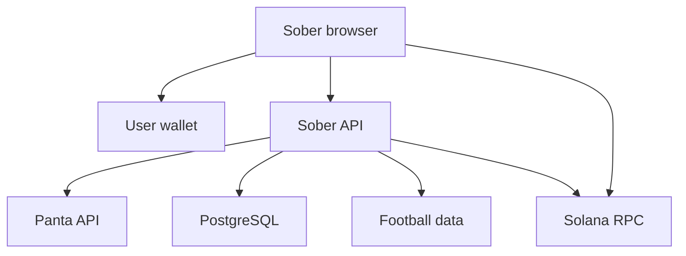

# Sober — Complete Vibecoder Build Specification

Version: 1.0 • 5 October 2026  
Product: football prediction companion powered by Panta  
Target: Colosseum Crypto World's Fair + Panta API Sidetrack  
Document language: Indonesian; application UI, repository README, and submission: English.

Dokumen ini adalah spesifikasi implementasi, bukan source code aplikasi yang sudah selesai. Gunakan sebagai konteks utama Cursor, Claude Code, Codex, Lovable, Bolt, atau tool coding lain. Jika tool hanya mendukung frontend, kerjakan bagian frontend dan kontrak integrasinya; jangan menyebut backend, transaksi, atau autentikasi selesai sebelum benar-benar dijalankan.

### Peta isi

| Bagian | Fokus |
|---|---|
| 0–4 | Master prompt, PRD, scope, football rules, user journeys |
| 5–7 | Stack, frontend per layar, Higgsfield dan scroll animation |
| 8–9 | Smart contract integration dan Panta contracts |
| 10–12 | Backend routes, DTOs, wallet auth, transaction recovery |
| 13–18 | Database, jobs, repository, env, security, evidence |
| 19–24 | Tests, prompts per fase, deployment, submission, references |

## 0. Master instruction untuk coding agent

Copy prompt berikut, lalu lampirkan seluruh file ini:

> Build Sober using this specification as the source of truth. Implement it in phases, starting with a working Panta integration spike and then the application foundation. Build a real football match companion, with match context, locked fan forecasts, Panta YES/NO purchases, wallet positions, eligible claims, admin market creation, attribution, and a reversible scroll-controlled penalty intro. Use English for all product UI. Use existing Panta smart contracts; do not deploy a custom prediction market contract. Protect server credentials, bind every financial action to the authenticated wallet, and keep on-chain confirmation separate from API submission and indexer updates. Never invent API endpoints, program IDs, token mints, prices, payout formulas, or transaction success. Mock mode must be explicitly labeled and must never submit transactions. Inspect current official documentation and the official playground before implementing adapters. Implement each phase's acceptance criteria, run relevant checks, and report completed work, actual validation, external blockers, and remaining work. If credentials or final video assets are unavailable, continue with independent application work and visibly document the blocked live integration. Do not silently replace real integration with simulated success.

### Aturan kerja agent

1. Baca repository dan instruksi lokal jika repository sudah ada; gunakan struktur yang kompatibel.
2. Jika repository baru, gunakan baseline di bagian 5; jangan menambah microservices yang belum diperlukan.
3. Implementasikan P0 per fase. P1/P2 tidak boleh menunda transaksi inti atau submission.
4. Buat `docs/implementation-status.md` dengan status `not started`, `in progress`, `verified`, atau `blocked` per fitur.
5. Buat `docs/integration-findings.md`: URL docs, tanggal pemeriksaan, network, mint, program, response shape, permission create, dan perbedaan dari dokumen ini.
6. Jika kontrak upstream berubah, perbarui adapter, test, dan catatan kontrak; jangan menyesuaikan data secara diam-diam.
7. Jangan memindahkan sponsor key ke browser walaupun contoh playground memperbolehkan input key secara interaktif.
8. Jangan otomatis membeli token, membayar biaya create, atau menandatangani transaksi. Pengguna/admin melakukan approval di wallet.
9. Jangan memublikasikan submission atau membuat klaim traction tanpa data dan instruksi pengguna.
10. Semua contoh ID, nominal, dan fixtures di dokumen ini adalah contoh kontrak, bukan aset atau transaksi valid.

## 1. Ringkasan produk

**Sober menyatukan konteks pertandingan, pendapat fans, dan transaksi prediction market dalam satu ruang pertandingan.**

Pengguna membaca Match Brief, menyimpan prediksi beserta alasan sebelum kickoff, lalu dapat membeli posisi YES/NO melalui Panta. Catatan prediksi gratis terpisah dari perdagangan. Setelah pertandingan, pengguna dapat membandingkan alasan awalnya dengan hasil dan memantau settlement serta claim melalui Panta.

Pembeda MVP:

- Football match context sebelum pengguna melihat form transaksi.
- Alasan prediksi yang terkunci sebelum kickoff, bukan komentar yang dapat diedit setelah hasil diketahui.
- Fan Signal dari suara wallet, dipisahkan dari harga Panta.
- Intro tendangan penalti dengan scroll maju/mundur dan transisi reversible ke UI.
- Status transaksi yang dapat diverifikasi melalui signature.

### Pengguna

| Persona | Kebutuhan | Aksi utama |
|---|---|---|
| Football fan | Memahami pertandingan dan mengungkapkan prediksi | Baca brief, simpan alasan, bagikan room |
| Solana wallet user | Review biaya dan membeli posisi | Quote, sign, positions, claim |
| Admin/host | Membuat room dan mendistribusikannya | Kurasi fixture, map/create market, share link |

### Ukuran keberhasilan internal

- Satu create market terdaftar dapat dibuktikan jika permission dan biaya memungkinkan.
- Setidaknya satu buy confirmed dengan signature, attribution, dan pembaruan positions.
- Claim diimplementasikan; demonstrasi nyata bergantung pada posisi eligible.
- Target riset: 4 dari 5 peserta uji memahami NO mencakup draw dan away win. Ini target internal, bukan syarat sponsor.
- Tidak ada duplicate broadcast akibat double click, retry status, atau refresh halaman.
- Intro forward, reverse, hold, Skip, reduced motion, dan media failure dapat diuji.
- Data internal test tidak dilaporkan sebagai external traction.

## 2. Scope dan prioritas

### P0 — release hackathon

| ID | Fitur | Hasil yang diperlukan |
|---|---|---|
| FR01 | Reversible penalty intro | Scroll down maju, scroll up mundur, stop hold, Skip/fallback |
| FR02 | Match discovery | Satu kompetisi, target 3–5 fixtures terkurasi |
| FR03 | Match Room | Brief, aturan YES/NO, sumber, harga dan phase Panta |
| FR04 | Wallet + signed-message auth | Wallet connect terpisah dari session login |
| FR05 | Primary buy | Quote → build → sign → broadcast → submit/verify → attribution |
| FR06 | Positions + eligible claim | Holdings nyata dan claim eligibility authoritative |
| FR07 | Locked fan forecasts | Satu forecast per wallet/market, edit sebelum cutoff |
| FR08 | Admin map/create | Review mapping, dynamic fee, create/register |
| FR09 | Share + evidence | Deep link langsung, metrik yang dapat ditelusuri |
| FR10 | Sync + recovery | Stale quote, wallet reject, RPC/API timeout, indexer lag |

### P1 — setelah P0 terverifikasi

- Creator fee claim pada market eligible.
- Forecast leaderboard, dengan label statistik dan aturan perhitungan jelas.
- Read-only embeddable match widget.
- Host customization ringan.

### P2 — sesudah hackathon

- Telegram Mini App, multi-competition, AI briefs, statistik lanjutan.
- Secondary trading hanya setelah kontrak API yang benar tersedia.

### Tidak masuk MVP

Custom betting/prediction smart contract, custom oracle, lending, leverage, liquidation, yield vault, real-time market making, guaranteed payout, live cashout, secondary sell, streaming pertandingan, chat realtime, auto-trading AI, dan prediksi selama pertandingan.

MVP dimulai dengan satu market nyata agar akses, biaya, dan lifecycle dapat dibuktikan. Target 3–5 rooms tidak berarti harus mendanai lima create sebelum fee aktual diketahui. Fixture tanpa mapping ditampilkan sebagai `Market unavailable`.

## 3. Football market rules

### 3.1 Template market

```text
Will {HOME_TEAM} beat {AWAY_TEAM} in regular time in {COMPETITION}
on {MATCH_DATE_WITH_TIMEZONE}?
```

Gunakan provider match ID dan kickoff UTC dalam metadata agar fixture tidak tertukar. Tanggal pada pertanyaan harus mempunyai zona waktu yang jelas. Question/rules yang sudah dibangun dan terdaftar tidak diedit untuk mengubah maksud market.

- **YES:** home team menang pada regular time, 90 menit + injury/stoppage time.
- **NO:** draw atau away team menang pada regular time.
- Extra time dan penalty shootout tidak dihitung.
- `Will the team qualify?` bukan template yang sama dan tidak masuk MVP.

Contoh resolution rule harus dibuat dari fixture nyata:

```text
Resolves YES if {HOME_TEAM} wins against {AWAY_TEAM} after 90 minutes
plus stoppage time in fixture {PROVIDER_MATCH_ID} of {COMPETITION}.
Resolves NO if the regular-time result is a draw or an {AWAY_TEAM} win.
Extra time and penalty shootouts are excluded. The official competition
result is the primary reference. Postponement, abandonment, cancellation,
and any refund treatment follow the market rules accepted by Panta.
```

Sebelum create, admin harus memastikan kebijakan kejadian khusus sesuai dukungan Panta; kalimat terakhir tidak menciptakan endpoint refund atau menjamin refund.

### 3.2 Time model

- DB menggunakan `timestamptz` UTC.
- UI menampilkan zona lokal pengguna dengan label timezone; admin dapat melihat UTC.
- Default product cutoff: kickoff snapshot minus 5 menit.
- `market_end_at` konsisten dengan cutoff yang disepakati.
- `forecast_cutoff_at` dibekukan saat publish.
- Jika mapping existing market tutup lebih awal, cutoff efektif tidak boleh melewati waktu penutupan market.
- Panta create memakai **Unix seconds**, bukan milliseconds dan bukan string ISO.
- `startTime < endTime <= resolutionTime`.
- Minimum start delay berasal dari konfigurasi upstream; angka sekitar satu jam dalam docs bukan nilai yang dihardcode.
- Market `opening soon` tidak bisa dibeli hanya karena belum kickoff.
- `resolutionTime` bukan janji settlement tepat pada jam tersebut.

### 3.3 Kondisi yang menutup pembelian

Buy hanya jika semua syarat benar:

```ts
session.wallet === intent.wallet
room.published === true
room.mappingStatus === "reviewed"
room.tradingPaused === false
fixture has not started, been postponed, cancelled, or abandoned
serverNow >= authoritative market start
serverNow < effective cutoff
market data is fresh enough for a write
Panta phase permits primary buying
```

Periksa di **quote dan build**, bukan hanya dengan disabled button. Jika cutoff lewat selama wallet approval, transaksi masih tunduk pada aturan on-chain Panta; jangan menjanjikan browser dapat membatalkan transaksi yang sudah ditandatangani/disiarkan. Jangan melakukan broadcast otomatis baru setelah cutoff.

### 3.4 Skor, settlement, payout

- Football provider menyediakan fixture/context/score; bukan otoritas claim.
- Skor final boleh menampilkan `Match finished, settlement pending`.
- Claim hanya berdasarkan posisi/status Panta dan validasi build claim.
- Admin tidak memiliki tombol yang mengubah outcome Panta melalui DB lokal.
- Payout estimate dinonaktifkan sampai rumus dan response yang benar dikonfirmasi. Dokumentasi posisi dan penjelasan produk Panta yang diperiksa mempunyai penjelasan payout berbeda.
- Tampilkan shares, biaya, dan eligibility; jangan memakai `shares × $1` sebagai janji payout.
- Endpoint win claim tidak diasumsikan melayani refund.

## 4. User journeys dan routes

### Fan journey

1. Buka home → scroll penalty atau Skip.
2. Pilih fixture → baca Match Brief, pertanyaan, rules, dan sources.
3. Connect Wallet → sign login challenge jika akan melakukan write.
4. Simpan forecast YES/NO dan reason. Pesan: `Prediction saved, no trade placed`.
5. Opsional beli posisi: amount → quote → review → wallet sign → confirmation.
6. Buka My Positions → tunggu Panta settlement → claim jika eligible.

### Admin journey

1. Login dengan wallet allowlist.
2. Sync/import fixture dari provider → cek waktu, kompetisi, dan sumber hasil.
3. Pilih existing Panta market atau buat market baru.
4. Review question, rule, source, times, image, dan dynamic fee.
5. Sign create → broadcast → register → simpan mapping.
6. Review mapping → publish room → copy share link.
7. Pantau evidence dan pending transactions. Skor tidak dipakai untuk resolve market.

| Route | Halaman | Akses |
|---|---|---|
| `/` | Intro + featured match + discovery preview | Public |
| `/matches` | Semua fixtures terkurasi | Public |
| `/matches/[matchId]` | Match Room | Public read; session untuk write |
| `/positions` | Wallet holdings + claims | Connected wallet + session untuk data personal |
| `/admin` | Fixtures, mapping, create, publish/pause | Admin session |
| `/admin/evidence` | Usage + verified transactions | Admin session |
| `/privacy` | Penjelasan data yang disimpan | Public |

Deep link room harus membuka detail langsung tanpa intro. Wallet tidak wajib untuk browse. Kembali melalui internal navigation tidak memutar ulang intro secara otomatis; `Replay intro` tersedia di home.

## 5. Technology baseline

Ini adalah keputusan implementasi proyek. Pilih versi paket yang kompatibel berdasarkan docs saat implementasi; pin lockfile setelah spike transaksi lulus. Jangan menulis nomor versi spekulatif.

| Layer | Baseline |
|---|---|
| App | Next.js App Router + React + TypeScript strict |
| Styling | Tailwind CSS + CSS variables |
| Accessible components | Radix-based components/shadcn jika kompatibel |
| Remote state | TanStack Query untuk refetch/polling client |
| Forms/schema | React Hook Form + Zod |
| Motion | GSAP + ScrollTrigger; HTML video sebagai baseline |
| Wallet | Solana wallet adapter + wallet-standard compatible wallets |
| Transaction SDK | `@solana/web3.js` compatible with Panta playground |
| Database | PostgreSQL; Supabase boleh sebagai managed Postgres |
| Data access | Drizzle ORM + versioned SQL migrations |
| Financial values | Decimal strings, BigInt base units; decimal library bila diperlukan |
| Football data | football-data.org v4 server adapter; provider plan checked |
| Tests | Vitest + Playwright untuk critical flows |
| Hosting | Vercel/Node hosting with supported scheduler and DB pooling |
| Media | Public immutable assets/CDN with mobile + desktop variants |

Gunakan satu Next.js codebase untuk frontend dan Route Handlers. Express/Nest/Laravel service terpisah tidak diperlukan untuk MVP. Jangan memasukkan Prisma sekaligus Drizzle atau dua library animation untuk pekerjaan yang sama.

### Architecture



Wallet signs locally. Server holds API credentials, validates business rules, persists intent, verifies status, and retries attribution. PostgreSQL is an application database, not the ledger for prediction shares or token balances.

## 6. Frontend specification

### 6.1 Design direction

Football atmosphere, cinematic hero, readable financial UI. Dark navy background, pitch-green accent, light text, restrained glass effects. Hindari glow berlebihan dan animasi angka keuangan saat review.

Suggested design tokens — proyek boleh menyesuaikan setelah kontras diuji:

```css
:root {
  --background: #080f18;
  --surface: #111e2d;
  --surface-raised: #1b2c40;
  --text-primary: #f4f7fb;
  --text-muted: #b8c5d4;
  --accent: #a7f36b;
  --yes: #a7f36b;
  --no: #ffb8a6;
  --border: #40516a;
  --danger: #ffc1b8;
  --radius-card: 20px;
}
```

- Container max width sekitar 1200 px.
- Mobile baseline 360 px; desktop mulai layout dua kolom sekitar 1024 px.
- Body text minimal 16 px untuk layar utama; number labels readable.
- Font heading: condensed sporty sans bila tersedia; body: readable sans. Host/subset fonts dengan benar.
- Warna YES/NO selalu disertai teks/icon.
- Touch targets sekitar 44 px dan focus ring jelas.
- UI English; timestamp, amount, dan status mempunyai format konsisten.
- Team logos/footage gunakan aset dengan hak penggunaan yang sesuai; logo placeholder jangan disebut official.

### 6.2 Shared shell

Header: Sober logo, Matches, My Positions, Connect Wallet. Admin link hanya untuk admin authenticated. Header tidak boleh menutupi focused content atau video hint.

Footer: product links, `Powered by Panta`, data-source note. Attribution juga muncul di modul Panta, bukan hanya footer.

Wallet menu: truncated address, copy address, network label, sign-in state, disconnect/logout. Koneksi wallet bukan bukti sudah authenticated.

### 6.3 Home

Komponen:

- `PenaltyIntro`
- `FeaturedMatchHero`
- `UpcomingMatches`
- `HowSoberWorks` tiga langkah ringkas
- `ProductFooter`

Featured match dipilih admin, bukan fixture simulasi yang tampil sebagai live. CTA `Open Match Room`. Bila tidak ada fixture: honest empty state + link Matches, tanpa odds palsu.

### 6.4 Match discovery

`MatchCard`: team names, competition, kickoff local + timezone, status, market availability. `Market unavailable`, `Opening soon`, `Prediction closed`, dan `Settlement pending` berbeda.

Filter sederhana: Upcoming / Finished. Satu competition MVP tidak memerlukan filter kompleks. Loading skeleton mempunyai tinggi stabil. Error menampilkan Retry; cached data diberi updated-at dan stale label.

### 6.5 Match Room

Desktop: kiri context/social, kanan trade panel sticky dalam bounds container. Mobile: context dulu, CTA `Trade YES / NO` membuka drawer; form state tetap saat drawer ditutup.

| Component | Isi |
|---|---|
| `MatchHeader` | Teams, competition, kickoff, fixture status |
| `MatchBrief` | Source, updated time, last five results/H2H jika tersedia |
| `MarketRules` | Question, YES/NO definition, cutoff, sources, regular time |
| `MarketSnapshot` | Panta prices, phase, updated time, attribution |
| `FanSignal` | YES/NO vote percentages + participant count |
| `ForecastForm` | Side + reason ≤280 characters + lock notice |
| `ForecastList` | Reasons, submitted time, wallet alias, edit/locked state |
| `TradePanel` | Side, amount, quote review, signing/status |
| `TransactionStatus` | Current stage, signature/explorer, recovery action |

Fan Signal = wallet votes; label `Fan votes — not market probability`. Tidak ada klaim satu wallet = satu orang. Forecast berbeda dari purchased positions, sehingga side forecast tidak diam-diam mengubah side order.

Missing H2H/last-five data: `Not available`, tanpa AI-generated statistic. Jangan melakukan N+1 provider calls per pengunjung; brief berasal dari server cache/curated content.

### 6.6 Buy panel

States: disconnected → sign-in required → input → quoting → review → building → wallet approval → confirmation → confirmed/update positions. Error state sesuai bagian 12.

Input amount sebagai string; maksimal enam decimal USDC, positif, batas produk server. Client validation hanya membantu UX. Jangan menggunakan JavaScript float untuk perhitungan keuangan.

Review menampilkan:

- Full question atau link aturan yang terlihat.
- YES/NO side, termasuk arti NO.
- Deposit amount in USDC.
- Estimated shares dan average price dari quote.
- Panta fee dari quote.
- Quote expiry countdown berdasarkan server time offset.
- Slippage tolerance default 1% (`100 bps`), perubahan eksplisit; jangan otomatis naik.
- Network fee in SOL, estimate jika tersedia; tidak menyebut USDC fee sudah termasuk SOL.
- Pesan estimasi dapat berubah dan aturan expiry.

Jika build mengubah shares/fee secara material, tampilkan review baru sebelum sign. Jangan memperlihatkan quote lama sebagai nilai pasti.

Untuk MVP tampilkan deposit dan fee sebagaimana didefinisikan docs/response; sebelum menambahkan `total debit`, pastikan apakah fee termasuk deposit atau tambahan. Jangan menjumlahkan fee dua kali berdasarkan asumsi.

### 6.7 Positions

- Fetch wallet positions dari Panta, termasuk market yang tidak lagi terkurasi oleh Sober.
- YES dan NO di market sama tampil terpisah berdasarkan stable position identity.
- Cards: market question, side, shares, phase, outcome, claim eligibility, latest transaction status.
- `Claim available` hanya saat eligible. Pending score tidak mengaktifkan tombol.
- Setelah chain confirmed tetapi indexer belum update: `Claim confirmed, updating position`.
- Zero positions: `No positions yet` + Browse Matches.
- Response capped/truncated: tampilkan notice; jangan mengklaim holdings lengkap jika API membatasi response.
- P&L dan estimated winnings tidak menjadi fitur P0.

### 6.8 Admin

Tabs: Fixtures, Market mapping, Create market, Evidence. Semua data/aksi protected server-side.

Create form memakai preview template, sources URL, image URL, times UTC + local, fee review. Admin harus sign dengan creator wallet sendiri; tidak ada private-key input.

Publish checklist: teams + competition + fixture identity + regular-time definition + dates + sources + market phase + register status. Similar title saja tidak cukup.

Pause trading menutup pembelian Sober; tidak membatalkan kontrak/market Panta. Publish/pause action dicatat di admin audit log.

### 6.9 Required English copy

| Situation | Copy |
|---|---|
| NO definition | `NO includes a draw or an away win.` |
| Forecast save | `Prediction saved, no trade placed.` |
| Confirmation | `Waiting for confirmation.` |
| Chain success, indexer lag | `Transaction confirmed, updating positions.` |
| Final score | `Match finished, settlement pending.` |
| Claim eligibility | `Claim available` |
| Null price | `Price unavailable` |
| Quote expiry | `Quote expired. Review a new quote.` |
| Uncertain RPC result | `Status not confirmed yet. Check this transaction before trying again.` |
| Simulation | `Simulation — no real funds or on-chain transactions.` |

## 7. Higgsfield asset + reversible intro blueprint

### 7.1 Asset responsibilities

Higgsfield dipakai untuk menghasilkan footage; browser code mengatur interaksi. Tidak perlu mengintegrasikan Higgsfield API di aplikasi MVP.

User memberikan video referensi penalty. Target satu shot 4–6 detik: player approach → foot contact → ball approaches camera → ball covers view/dark frame. Konsistensi kaki, bola, kamera, dan lighting lebih penting dari banyak cut.

Suggested production prompt, sesuaikan reference dan kemampuan model:

```text
A single continuous cinematic football penalty shot in a floodlit stadium.
Preserve the reference player's run-up and realistic kick mechanics.
The camera stays consistent as the football accelerates towards the viewer,
fills the frame, and ends in a dark navy visual that can blend into a website.
Realistic anatomy, one football, coherent ball trajectory, no cuts,
no text, no logos, no UI, no watermark. Silent footage.
```

Deliver assets:

```text
public/intro/penalty-desktop.mp4
public/intro/penalty-mobile.mp4
public/intro/poster-desktop.webp
public/intro/poster-mobile.webp
```

Poster/logo/UI dibuat terpisah. Video-generated text/buttons tidak bisa menjadi UI fungsional. Jika footage belum ada, placeholder poster harus terlihat sebagai placeholder; jangan mengklaim scrub video sudah verified.

### 7.2 Interaction timeline

| Scroll progress | Scene | UI |
|---|---|---|
| 0–25% | Ready + run-up | Scroll to kick, Skip intro |
| 25–55% | Foot contact | Full viewport footage |
| 55–80% | Ball towards viewer | Blend towards hero palette |
| 80–95% | Ball covers view | Video fades; actual HTML hero reveals |
| 95–100% | Final frame | Hero interactive; normal scroll continues |

Scroll down advances. Scroll up reverses. Stop scrolling holds after short configured smoothing. Primary controller is scroll progress, not autoplay or playbackRate hacks.

### 7.3 Runtime requirements

- Client-only `PenaltyIntro` with GSAP context/cleanup and ScrollTrigger `pin` + `scrub`.
- Default scroll distance around `2.5 × viewport height`, tuned after testing; not hardcoded desktop pixels.
- Single normalized progress controls video time, opacity, transforms, and interaction state.
- Set time after metadata loaded; clamp to seekable bounds/duration minus a small epsilon where needed.
- Use `requestAnimationFrame` to coalesce seeks; avoid a growing queue of `currentTime` assignments.
- `playsInline`, `muted`, poster, no scrubbed audio.
- Do not run ScrollTrigger in React server component.
- Refresh after assets/layout load; clean up on route change/resize to prevent duplicate triggers.
- Intro DOM stays mounted when progress reaches end so reverse remains possible.
- Outside active stage set pointer events appropriately; hero becomes focusable/clickable only when visible.
- Use `inert`/focus management for hidden interactive hero; do not leave inaccessible hidden buttons in tab order.
- Skip targets actual intro end after pin setup; move focus to main heading.
- Reduced motion/media error/load timeout renders static hero and working navigation.
- Direct room links bypass intro.
- Replay restarts intro intentionally; internal navigation back can use session memory to land on hero without forced replay.

Conceptual logic, **not drop-in GSAP code**:

```ts
function renderProgress(progress: number, duration: number) {
  const p = clamp(progress, 0, 1);
  const reveal = clamp((p - 0.80) / 0.15, 0, 1);
  scheduleVideoSeek(p * Math.max(duration - 0.04, 0));
  setVideoOpacity(1 - reveal);
  setHeroOpacity(reveal);
  setHeroTranslateY((1 - reveal) * 24);
  setHeroInteractive(p >= 0.95);
}
```

### 7.4 Media performance

- Initial design budget approximately 5 MB intro transfer, max six seconds; measure actual device/network results.
- Encode seek-friendly MP4 with frequent keyframes; compare compression and seeking before choosing final GOP.
- Do not eagerly download desktop and mobile video together.
- Keep actual hero content accessible while media is pending; Skip always available.
- If mobile reverse seek remains poor, use compressed image sequence on canvas with bounded adjacent-frame cache.
- Canvas fallback: manifest, frame count, aspect ratio, cache limit, preload-neighbor strategy, abort fetch on navigation. Do not decode full-resolution sequence entirely on mobile.
- Canvas backing size respects DPR with a tested cap, e.g. 2; resize without stretching.
- Avoid unnecessary WebGL/Three.js; use it only if the asset/runtime needs true 3D.

### 7.5 Intro acceptance

- Test down, up, stop, resize, Skip, Replay, direct links.
- Reverse from revealed hero makes video appear again without remount artifacts.
- Test Chrome desktop and actual mobile Safari/Chrome when available; record devices tested.
- Keyboard navigation and reduced motion remain usable.
- Missing video/slow connection opens static hero, not a blank loading wall.

## 8. Smart contract / on-chain scope

### 8.1 Required MVP decision

**Do not write or deploy a new Anchor/Rust/Solidity prediction contract for this MVP.** Panta provides the market infrastructure and unsigned transaction building. Adding a parallel prediction contract would create another settlement/balance system and weaken the intended integration.

The smart-contract task for Sober is an integration module:

| Responsibility | Owner |
|---|---|
| Prediction market state, shares, fees, settlement, eligible claim | Panta contracts/infrastructure |
| Unsigned instructions/create transaction | Panta API |
| Transaction decoding/compilation/sanity checks | Sober client module + server policy |
| Approval/signing | User wallet |
| Execution and on-chain confirmation | Solana |
| Fixtures, forecasts, permissions, evidence | Sober server/database |

### 8.2 On-chain integration deliverables

- `src/lib/solana/instructions.ts`: typed instruction decoding.
- `src/lib/solana/versioned-transaction.ts`: buy/claim compilation + create deserialization.
- `src/lib/solana/transaction-policy.ts`: expected wallet, program/account/mint validation based on verified configuration and official helpers.
- `src/lib/solana/confirmation.ts`: blockhash-aware confirmation/recovery.
- `src/lib/solana/signature-recovery.ts`: preserve signed transaction identity before uncertain broadcast.
- `src/lib/solana/explorer.ts`: network-correct signature links.
- `docs/onchain-integration.md`: verified network, mint, program, instruction formats, confirmation commitment, and evidence.

Do not invent Panta IDL/program address. Obtain official configuration/IDL if available and verify against API responses and chain. If exact semantic instruction decoding is unavailable, document the verification limits and use the official validated builder, wallet review, and upstream verifier; do not claim full independent auditing.

### 8.3 Instructions build vs serialized build

Buy and win claim return ordered instructions. Create returns base64 serialized unsigned `VersionedTransaction` under `transaction`.

```ts
// Example mapping for the documented instruction shape.
const instructions = response.instructions.map((ix) =>
  new TransactionInstruction({
    programId: new PublicKey(ix.programId),
    keys: ix.accounts.map((account) => ({
      pubkey: new PublicKey(account.pubkey),
      isSigner: account.isSigner,
      isWritable: account.isWritable,
    })),
    data: decodeBase64ToBytes(ix.data),
  }),
);
// Use the actual compatible SDK's required binary type.
const message = new TransactionMessage({
  payerKey: connectedWalletPublicKey,
  recentBlockhash: response.recentBlockhash,
  instructions,
}).compileToV0Message();
const transaction = new VersionedTransaction(message);

// Create response uses a different path:
const createTransaction = VersionedTransaction.deserialize(
  decodeBase64ToBytes(createResponse.transaction),
);
```

Validate required signer(s), fee payer, network, expected programs/accounts, and transaction integrity. If a build uses lookup tables or additional signers, use the actual supported format/helper; do not guess. Do not replace embedded create blockhash or reorder instructions. Rebuild through Panta before signing when needed.

### 8.4 Custody and safety boundaries

- No user private keys, seed phrases, or custody wallets in server/database.
- No automatic rebroadcast of a newly signed replacement when status is uncertain.
- No contract method guessed from a field name.
- Forecasts are application records; do not call them on-chain/verifiable by chain unless an actual design is added later.
- Custom on-chain forecast attestation may be explored post-MVP, with explicit cost/privacy design; not a release requirement.

## 9. Panta adapter and current API contract

Baseline checked on 5 October 2026. Recheck during phase 0. External contracts below belong to Panta; internal DTOs in section 10 belong to Sober.

Base URL: `https://live-api.panta.market/api/v1`  
Header: `X-Api-Key: <server secret>`  
Use documented trailing slashes. Key prefix `pk_test_` does not prove devnet.

### 9.1 Endpoint map

| Operation | Panta endpoint | Notes |
|---|---|---|
| List markets | `GET /markets/` | Cursor pagination; filter sports where supported |
| Detail | `GET /markets/{marketId}/` | Live/detail prices may be unavailable |
| Quote buy | `POST /primaryorderquote/` | Human-readable amount decimal string |
| Build buy | `POST /primaryorderbuild/` | Instructions + orderId + blockhash |
| Submit buy | `POST /primaryordersubmit/` | Registers signature; does not prove success |
| Verify buy | `POST /primaryorderverify/` | Built/submitted/confirmed/failed/expired |
| Positions | `GET /positions/?wallet=...` | Shares + claimable/claimed, possible lag/cap |
| Build win claim | `POST /claim/build/` | On-chain eligibility revalidated |
| Attribute trade | `POST /trades/` | Verified primary buy or win claim only |
| Create quote | `POST /markets/create/quote/` | Rules/times/image + base-unit fees |
| Create build | `POST /markets/create/build/` | Serialized unsigned transaction |
| Register create | `POST /markets/register/` | Verify create and register catalog |
| Creator fees P1 | `POST /claim/creator-fees/build/` | Eligible graduated creator fees only |
| Evidence | `GET /account/metrics/` | Admin/server only, inspect aggregation definitions |

### 9.2 Request payloads

Values come from authenticated session and stored intent, never arbitrary client-supplied wallet/userId:

```ts
// Quote buy
{
  wallet: session.walletAddress,
  marketId: reviewedRoom.pantaMarketId,
  side: "yes", // or "no"
  amountUsdc: "5.00",
  userId: serverAttributionId
}

// Build buy
{
  quoteId: intent.quoteId,
  wallet: session.walletAddress,
  userId: serverAttributionId,
  maxSlippageBps: 100
}

// Submit buy
{ orderId: intent.orderId, signature, wallet: session.walletAddress }

// Verify buy
{ orderId: intent.orderId, signature, wallet: session.walletAddress }

// Build win claim
{ wallet: session.walletAddress, marketId: validatedPosition.marketId }

// Report trade; response determines actual verified kind.
{
  signature,
  wallet: session.walletAddress,
  marketId: intent.pantaMarketId,
  quoteId: intent.quoteId ?? undefined,
  clientOrderId: intent.id,
  userId: serverAttributionId
}

// Create quote
{
  wallet: adminSession.walletAddress,
  question: frozenQuestion,
  resolutionRule: frozenRule,
  sourcesOfTruth: reviewedSourceUrls,
  category: "sports",
  startTime: unixSeconds(marketStart),
  endTime: unixSeconds(marketEnd),
  resolutionTime: unixSeconds(resolutionTime),
  imageUrl: permanentPublicImageUrl,
  marketType: "standard"
}

// Create build
{ createId: intent.createId, wallet: adminSession.walletAddress }

// Register
{ createId: intent.createId, signature }
```

Do not send `kind: "claim"` merely to force classification; trade reporter infers/verifies the actual on-chain kind. Panta attribution ID is server-derived and stable, e.g. `sober:<user UUID>` if accepted. Do not reveal personal email in attribution.

Create validation baseline dari docs: question ≤512 characters, resolutionRule ≤2048, sourcesOfTruth nonempty and ≤20 entries, imageUrl one public permanent URL ≤2048 characters. Image 1024×1024 square adalah rekomendasi, bukan hard API requirement. `eventInProgress` hanya untuk breaking markets; MVP standard tidak menggunakan flag ini untuk melewati minimum start delay. `paymentUsdc` bukan fee yang ditentukan browser; gunakan fee on-chain yang dikembalikan quote.

### 9.3 Response details to normalize

| Response | Required fields to inspect |
|---|---|
| Quote buy | quoteId, marketId/side/amount binding, shares, avgPrice, feeUsdc, expiresAt |
| Build buy | orderId, quoteId, wallet, marketId, side, expectedShares, feeUsdc, instructions, recentBlockhash, lastValidBlockHeight, expiresAt |
| Submit | orderId, signature, status submitted |
| Verify | orderId, signature, status, marketId/side; documented amountUsdc example uses base units |
| Claim build | wallet, marketId, outcome, winningShares, instructions, derived, recentBlockhash, lastValidBlockHeight |
| Create quote | createId, expectedEventPda, paymentUsdc, liquidityInjectionUsdc, platformRevenueUsdc, expiresAt |
| Create build | createId, expectedEventPda, transaction, blockhash/height, buildFingerprint, fees, expiresAt |
| Register | marketId, createId, signature, status registered |
| Trade report | signature, marketId, wallet, side if applicable, kind, status processed |

Retain `buildFingerprint` and expected event where returned for traceability. Unknown phase/status becomes unsupported/read-only, not assumed primary.

### 9.4 Money and time normalization

- Buy quote `amountUsdc` is human-readable decimal string.
- Buy quote `feeUsdc` is human-readable decimal string.
- Create `paymentUsdc`, liquidity injection, and revenue are integer strings in USDC base units (six decimals).
- Verify example `amountUsdc` is base units despite the same field name; endpoint-specific schema is mandatory.
- For verified actual volume use upstream/on-chain verified amounts, not requested client amount.
- Values received as unsafe JS numbers must be rejected/parsed losslessly; do not round a large integer and call it exact.
- Quote/order/session TTL uses returned `expiresAt`. Approximate durations in docs are not product guarantees.
- Claim build does not necessarily have quote-style `expiresAt`; use blockhash + lastValidBlockHeight and actual response.
- JSON outputs serialize BigInt as strings.

Required utility behavior:

```ts
parseUsdcToBaseUnits("1.234567") === 1234567n
formatUsdcBaseUnits(1234567n) === "1.234567"
parseUsdcToBaseUnits("0.0000001") // reject excessive precision
parseUsdcToBaseUnits("1e3")       // reject exponent input
parseUsdcToBaseUnits("-1")        // reject negative deposit
```

Reject separators on API payload; UI may format only display. Preserve share precision from upstream; do not truncate all shares to six decimals.

### 9.5 Adapter interface

```ts
interface PantaClient {
  listMarkets(input: MarketListInput): Promise<MarketPage>;
  getMarket(marketId: string): Promise<PantaMarket>;
  quoteBuy(input: QuoteBuyInput): Promise<PantaBuyQuote>;
  buildBuy(input: BuildBuyInput): Promise<PantaBuyBuild>;
  submitBuy(input: SubmitBuyInput): Promise<PantaSubmitResult>;
  verifyBuy(input: VerifyBuyInput): Promise<PantaVerifyResult>;
  getPositions(wallet: string): Promise<PantaPositionsResult>;
  buildClaim(input: ClaimBuildInput): Promise<PantaClaimBuild>;
  reportTrade(input: TradeReportInput): Promise<PantaTradeReport>;
  quoteCreate(input: CreateQuoteInput): Promise<PantaCreateQuote>;
  buildCreate(input: CreateBuildInput): Promise<PantaCreateBuild>;
  registerMarket(input: RegisterMarketInput): Promise<PantaRegisterResult>;
}
```

Implement response schemas from current official examples + observed responses. Do not use `any` throughout the adapter. Preserve upstream error code and fields; redact secrets/large instruction payloads in logs.

No global cache for quotes/builds. Cache browse/detail per market with timestamp. Honor 429 `Retry-After`; do not blindly retry financially meaningful writes after unknown network results.

## 10. Backend and internal API contracts

### 10.1 Server services

- `AuthService`: nonce challenge, signature verification, sessions, admin permission.
- `FixtureService`: provider sync, curated fixture reads, brief cache.
- `RoomService`: mapping, frozen rules, publish/pause, cutoff eligibility.
- `ForecastService`: atomic cutoff-enforced upsert, summaries, moderation.
- `OrderService`: idempotent quote/build, intent ownership, submit/verify.
- `ClaimService`: position eligibility, build, signature recovery, confirmation.
- `CreateMarketService`: admin fee quote/build/register/mapping.
- `ReconciliationService`: separate chain, upstream, indexing, attribution states.
- `EvidenceService`: verified metrics, internal/external separation.

### 10.2 Response envelope

```ts
type ApiResult<T> =
  | {
      ok: true;
      data: T;
      meta: {
        requestId: string;
        serverTime: string;
        fetchedAt?: string;
        source?: "panta" | "football" | "sober" | "simulation";
        stale?: boolean;
      };
    }
  | {
      ok: false;
      error: {
        code: string;
        message: string;
        retryable: boolean;
        requestId: string;
        fields?: Record<string, string>;
      };
    };
```

HTTP: 400 validation, 401 auth missing/expired, 403 forbidden, 404 missing, 409 idempotency/state conflict, 429 rate limit, 502/503 upstream failure. No stack traces or sponsor credentials in responses.

### 10.3 Internal routes

| Method / route | Access | Input / behavior |
|---|---|---|
| POST `/api/auth/nonce` | Public limited | walletAddress → nonceId, exact message, expiry |
| POST `/api/auth/verify` | Public limited | nonceId, signature; verify exact stored challenge |
| GET `/api/auth/session` | Session optional | wallet, role, expiry; no session token |
| POST `/api/auth/logout` | Session | Revoke and clear cookie |
| GET `/api/matches` | Public | Curated paginated list, status filter |
| GET `/api/matches/[id]` | Public | Fixture + room + brief + source timestamps |
| GET `/api/markets/[roomMarketId]` | Public | Normalized Panta detail for mapped room |
| GET `/api/forecasts?roomMarketId=...` | Public | Visible reasons + aggregate; no sensitive user data |
| POST `/api/forecasts` | Session | side/reason; atomic cutoff write |
| POST `/api/orders/quote` | Session | roomMarketId, side, amountUsdc, idempotencyKey |
| POST `/api/orders/build` | Intent owner | intentId, maxSlippageBps; quote from stored intent |
| POST `/api/orders/[intentId]/submit` | Intent owner | signature; persist then upstream submit |
| GET `/api/orders/[intentId]/status` | Intent owner | Chain/upstream/indexer states + recovery |
| GET `/api/positions` | Session | Wallet exclusively from session |
| POST `/api/claims/build` | Session | marketId, position identity, idempotencyKey |
| POST `/api/claims/[intentId]/submit` | Intent owner | signature; no invented upstream claim-submit endpoint |
| GET `/api/claims/[intentId]/status` | Intent owner | RPC + positions + attribution status |
| POST `/api/admin/fixtures/sync` | Admin | Known competition/date bounds |
| POST `/api/admin/rooms/map` | Admin | matchId, Panta market ID + review fields |
| POST `/api/admin/markets/quote` | Admin | Draft fixture/rules/times/image + idempotencyKey |
| POST `/api/admin/markets/build` | Admin intent owner | intentId |
| POST `/api/admin/markets/register` | Admin intent owner | intentId, signature |
| POST `/api/admin/rooms/[id]/publish` | Admin | Validate mapping then publish |
| POST `/api/admin/rooms/[id]/pause` | Admin | paused + reason |
| GET `/api/admin/evidence` | Admin | Verified aggregates, signatures, test labels |
| POST `/api/analytics/events` | Public limited | Allowlisted nonfinancial events |
| POST `/api/jobs/sync` | Job secret | Bounded sync + reconciliation batch |
| GET `/api/health` | Public minimal | Readiness without config secrets |

Quote/build use no browser-supplied upstream userId/wallet. Claim of unmapped Panta market is allowed if verified holdings exist; My Positions must not depend entirely on room curation.

### 10.4 Example normalized frontend DTOs

These are **Sober DTOs**, not raw Panta responses. Map them in adapter/services.

```ts
type Side = "yes" | "no";
type DataSource = "panta" | "football" | "sober" | "simulation";

interface SoberDto {
  match: {
    id: string;
    homeTeam: string;
    awayTeam: string;
    competition: string;
    kickoffAt: string;
    status: string;
    sourceUrl: string | null;
    updatedAt: string | null;
  };
  room: {
    id: string;
    pantaMarketId: string;
    question: string;
    resolutionRule: string;
    rulesVersion: number;
    sources: string[];
    cutoffAt: string;
    tradingPaused: boolean;
  } | null;
  market: {
    phase: string;
    yesPrice: string | null;
    noPrice: string | null;
    fetchedAt: string;
    stale: boolean;
  } | null;
  eligibility: {
    canQuote: boolean;
    reasonCode: string | null;
  };
}

interface BuyQuoteDto {
  intentId: string;
  walletAddress: string;
  pantaMarketId: string;
  side: Side;
  amountUsdc: string;
  estimatedShares: string;
  averagePrice: string;
  feeUsdc: string;
  expiresAt: string;
}

interface InstructionDto {
  programId: string;
  data: string; // base64
  accounts: { pubkey: string; isSigner: boolean; isWritable: boolean }[];
}

type UnsignedBuildDto = {
  intentId: string;
  walletAddress: string;
  recentBlockhash: string;
  lastValidBlockHeight: number;
  expiresAt?: string;
} & (
  | { format: "instructions"; instructions: InstructionDto[] }
  | { format: "serialized"; transactionBase64: string }
);

interface TransactionStatusDto {
  intentId: string;
  signature: string | null;
  chainStatus: "unknown" | "pending" | "confirmed" | "finalized" | "failed";
  pantaStatus: string | null;
  attributionStatus: "not_applicable" | "pending" | "processed" | "failed";
  indexingPending: boolean;
  canSafelyRestart: boolean;
  message: string;
  explorerUrl: string | null;
}
```

`canSafelyRestart` must be derived from positive evidence of expiry/non-execution and business state, not from elapsed HTTP timeout.

## 11. Wallet authentication and permissions

### Signed-message login

1. Browser sends selected wallet public key to nonce endpoint.
2. Server generates cryptographically random nonce; stores hash, wallet, domain, exact challenge, expiry.
3. Challenge explains domain, purpose, nonce, issued time, expiry; e.g. `Sign in to Sober. This does not authorize a trade.`
4. Wallet signs exact message bytes.
5. Server verifies Ed25519 signature, wallet, domain and stored challenge. Consume nonce atomically if not expired/used.
6. Create opaque random session token; DB stores only token hash.
7. Cookie `HttpOnly`, `Secure` in HTTPS production, `SameSite=Lax`, `Path=/`. Local HTTP development may use secure=false only in development.

Default nonce TTL 5 minutes, session TTL 12 hours, configurable. Do not call Panta account email/JWT login the fan login; sponsor account/key provisioning is separate.

Admin role from server allowlist, enforced per request; DB role field is not self-registration input. Remove allowlisted wallet access immediately when configuration changes or session is revoked.

Wallet change/disconnect clears client query cache for personal data, revokes/logs out session as applicable, and cancels unbroadcast intent UI. Already-broadcast signatures remain recoverable by their owning wallet after reconnect.

Write endpoints require trusted Origin + session, except tightly validated auth entry points/job route. Apply origin protection to auth endpoints too. Job route requires secret authentication and rejects public invocation. Use CSRF protection appropriate to deployment, same-origin fetch and cookie policy; do not rely on hidden button.

## 12. Transaction lifecycle and recovery

### 12.1 Primary buy

1. Validate session, room, amount, side, live phase/time, fresh data, and idempotency key.
2. Atomically reserve local intent. Call quote outside long DB transaction, store normalized result.
3. User reviews exact quote. Changing side/amount invalidates quote and creates a new reviewed intent.
4. Build from stored quote; recheck cutoff and wallet binding.
5. Decode/compile, validate, and request wallet sign.
6. After signing, derive transaction signature from signed bytes and persist a local recovery marker **before** RPC send. Do not log/store signed payload as analytics.
7. Broadcast signed bytes. When request times out, retain derived signature and check the same transaction.
8. Persist signature to Sober; server submits associated order to Panta.
9. Poll RPC + Panta verify. `submitted` is pending.
10. After successful verification, report attribution, update actual verified amount, refresh positions.

Local marker: network, intentId, signature, wallet, marketId, blockhash, lastValidBlockHeight. Use session-scoped client persistence with clear retention and no secrets. Pending intent also recoverable from server when signature was acknowledged. If tab closes before server acknowledgement, recover marker on next load; do not auto-create another order.

Use state separation:

```ts
type IntentState =
  | "draft" | "quoting" | "quoted" | "building" | "built"
  | "awaiting_signature" | "signed" | "broadcast_pending"
  | "submitted" | "confirmed" | "indexed"
  | "rejected" | "expired_before_broadcast" | "failed"
  | "reconciliation_required";
```

Chain success, Panta verification, attribution, and position indexing have independent fields. UI may show `On-chain confirmed, syncing with Panta` when evidence differs. Do not display end-to-end verified success while upstream association is unresolved.

### 12.2 Idempotency and concurrency

- UUID idempotency key per intended action; stable for retry of the same payload.
- Unique `(user_id, idempotency_key)` plus canonical request hash.
- Same key + same payload returns existing intent/result.
- Same key + different payload returns 409.
- Signature unique globally; an existing signature cannot be rebound to another user/intent.
- Atomic per-intent operation reservation/lease prevents two concurrent build handlers.
- Do not hold DB locks over long external calls; use short atomic status/lease updates.
- Unknown outcome of upstream call becomes reconciliation state; never assume retrying any POST is safe.
- Explicit Panta safe retries: same orderId/signature submit; same createId/signature register; same signature trade report.
- Double click disables UI but server constraints remain required.
- Pending broadcast prevents issuing a replacement buy for the same intended action until status is resolved.
- DB uniqueness alone does not guarantee exactly-once on-chain execution. Test signed transaction handling and replacement prevention.

### 12.3 Confirmation

- Use returned blockhash and `lastValidBlockHeight` with compatible confirmation strategy.
- Confirmation commitment at least `confirmed`; finalization can be tracked separately.
- RPC returns error → transaction failed; RPC timeout/absence → unknown/pending.
- Check expiry by block height, not just fixed seconds.
- Panta session `expired` after broadcast does not prove the chain transaction failed.
- Rebuilding is safe only before broadcast or after non-execution is established. When uncertain, provide Check status and preserve signature.
- If provider cannot give sufficient evidence, leave unresolved and explain rather than automatically replacing.

### 12.4 Win claim

1. Load Panta positions and check claimable/not claimed.
2. Bind claim intent to session wallet and verified market; block duplicate pending claim intent.
3. Panta build revalidates eligibility. `NOT_CLAIMABLE` stops flow.
4. Compile/sign/persist signature/broadcast using same recovery approach.
5. Confirm via RPC. There is no assumed `/claim/submit/` or `/claim/resolve/` endpoint.
6. Report signature with `/trades/`, then refresh positions.
7. Indexer lag: `Claim confirmed, updating position`; do not prompt a second claim.

### 12.5 Admin create

1. Freeze draft metadata/rules and check fixture/time/source/image.
2. Quote create; display fee from response after converting base units.
3. Admin approves fee; build returns serialized transaction.
4. Validate/deserialise/sign/persist signature/broadcast.
5. Confirm chain, then register same createId/signature.
6. Register response marketId must match expected event where available.
7. Save room mapping; reviewed + published only after checks pass.
8. Registration failure after chain success is a registration recovery task, not permission to pay create fee again.

### 12.6 Failure matrix

| Condition | Behavior |
|---|---|
| Quote expired | New quote + user review; never sign expired quote |
| QUOTE_STALE | Requote and review; don't raise slippage automatically |
| Wallet rejects | Return to review; mark rejected; no success |
| Wallet switches | Re-auth; old unsigned quote invalid |
| Insufficient USDC/SOL | Show balance/fee requirement; preserve input |
| RPC timeout during send | Use derived signature; reconcile same transaction |
| API submit failure | Store signature; retry known idempotent association |
| API verify expired, chain success | Reconcile attribution/indexing; no replacement buy |
| Chain error | Show failure + explorer, safe restart only after validation |
| Indexer lag | Confirmed/update state; refetch with backoff |
| Trade report delayed | Retry same signature; never rebroadcast |
| Create registered late/fails | Preserve createId/signature, admin recovery |
| NOT_CLAIMABLE | Waiting/refresh; no synthetic eligibility |
| 429 | Honor Retry-After; backoff with jitter |
| Cutoff/postponed | Read-only room; reviewed recovery by admin |

## 13. Database schema

PostgreSQL, UUID local IDs, text public keys/signatures, UTC timestamps, JSONB metadata. Drizzle migration should implement constraints below. Fields marked cache are not authoritative financial balances.

This expands the original PRD with request hash, operation leases, blockhash recovery metadata, and audit logs needed for coding.

### 13.1 Table definitions

| Table | Key fields and constraints |
|---|---|
| `users` | id UUID PK, wallet_address unique not null, display_name varchar(40) nullable, role fan/admin, created_at, updated_at |
| `matches` | id, provider, provider_match_id, competition_code, teams IDs/names, kickoff_at, status, regular scores nullable, result_source_url, provider_updated_at, synced_at, brief_json, is_curated, is_featured; unique provider+provider_match_id |
| `room_markets` | id, match_id FK, panta_market_id unique, featured_team_id, immutable question/rule/sources/rules_version/times, panta_phase/outcome cache, mapping_status, published, trading_paused, pause_reason, creator FK, created_at, updated_at |
| `fan_forecasts` | id, user_id FK, room_market_id FK, side yes/no, reason varchar(280), rules_version, submitted_at, updated_at, locked_at nullable, moderation_status; unique user+room |
| `order_intents` | id, user_id FK, room nullable FK, market ID nullable for pre-create, kind buy/claim/create/creator_fee_claim, wallet snapshot, amount/side, idempotency_key/request_hash, quote/order/create IDs, expected_event, fee units, shares string, statuses, expiry, operation lease, build metadata, timestamps |
| `transactions` | id, intent FK, signature unique, wallet, market ID, network, kind, chain/panta/attribution/indexer statuses, confirmed amount base units, blockhash/height, block_time, error, last_checked_at |
| `auth_nonces` | id, wallet, nonce_hash unique, domain, exact challenge, issued/expires/consumed_at |
| `auth_sessions` | id, user FK, token_hash unique, issued/expires/revoked_at |
| `analytics_events` | id, anonymous session, user nullable, room nullable, allowlisted name/properties, internal_test, occurred_at |
| `admin_audit_logs` | id, admin_user FK, action, entity type/ID, before/after nonsecret snapshots, occurred_at |

Field expansions untuk migrasi yang tidak boleh ditebak:

- `matches`: `home_team_id`, `away_team_id`, `home_team_name`, `away_team_name` text; `regular_home_score`, `regular_away_score` smallint nullable dengan check nonnegative; `kickoff_at`, `provider_updated_at`, `synced_at`, `created_at`, `updated_at` timestamptz. `is_curated`/`is_featured` boolean default false. Public discovery hanya membaca curated fixtures. Tetapkan maksimal satu featured fixture melalui constraint/service transaction.
- `fan_forecasts`: `side` text checked yes/no; `reason` varchar(280); `rules_version` integer; `moderation_status` checked visible/reason_hidden/invalidated. Counts exclude invalidated records; reason_hidden masih menyumbang vote sesuai aturan moderasi.
- `order_intents`: `wallet_address` text NOT NULL snapshot; `kind`, `side`, `local_status`, `upstream_status` text; `quote_id`, `order_id`, `create_id`, `expected_event_pda` text nullable; `draft_payload` jsonb nullable untuk frozen create fields; `build_metadata` jsonb minimal; `request_hash` text; `expires_at`, `operation_lease_until`, `created_at`, `updated_at` timestamptz. `internal_test` boolean server-managed. Buy/claim wajib market ID, create boleh nullable sampai expected/confirmed address tersedia.
- `transactions`: `network`, `kind`, `wallet_address`, `chain_status`, `attribution_status` text NOT NULL; `panta_status` nullable; `indexing_pending` boolean; `finalized_at`, `block_time`, `last_checked_at`, `created_at` timestamptz nullable as appropriate; `error_code` text nullable. Signature ownership immutable setelah insert.
- `auth_nonces`: `challenge_message` text NOT NULL; server memverifikasi byte pesan yang sama. `nonce_hash` dan `token_hash` bukan raw nonce/session token. Nonce asli hanya terdapat pada challenge untuk signing.
- `analytics_events`: `internal_test` boolean server-derived default false; `properties` jsonb allowlist. Cohort untuk signed-in user ditentukan server, bukan parameter publik yang dapat mengubah financial evidence.
- UUID dibuat dengan crypto-safe generator aplikasi atau DB function yang dikonfigurasi migrasi. `updated_at` diperbarui repository/trigger secara konsisten, tidak diasumsikan otomatis oleh PostgreSQL.
- Nullability yang belum disebut harus ditetapkan eksplisit dalam schema; jangan menjadikan semua kolom optional agar validation lolos.

### 13.2 Detailed `room_markets` contract

```sql
CREATE TABLE room_markets (
  id uuid PRIMARY KEY,
  match_id uuid NOT NULL REFERENCES matches(id),
  panta_market_id text NOT NULL UNIQUE,
  featured_team_id text NOT NULL,
  question text NOT NULL,
  resolution_rule text NOT NULL,
  rules_version integer NOT NULL CHECK (rules_version > 0),
  sources_of_truth jsonb NOT NULL,
  market_start_at timestamptz NOT NULL,
  market_end_at timestamptz NOT NULL,
  resolution_at timestamptz NOT NULL,
  forecast_cutoff_at timestamptz NOT NULL,
  panta_phase text,
  panta_outcome text,
  market_synced_at timestamptz,
  mapping_status text NOT NULL DEFAULT 'draft'
    CHECK (mapping_status IN ('draft','reviewed','needs_review','archived')),
  published boolean NOT NULL DEFAULT false,
  trading_paused boolean NOT NULL DEFAULT false,
  pause_reason text,
  created_by_user_id uuid NOT NULL REFERENCES users(id),
  created_at timestamptz NOT NULL DEFAULT now(),
  updated_at timestamptz NOT NULL DEFAULT now(),
  CHECK (market_start_at < market_end_at),
  CHECK (market_end_at <= resolution_at),
  CHECK (forecast_cutoff_at <= market_end_at),
  CHECK (NOT published OR mapping_status = 'reviewed'),
  CHECK (jsonb_typeof(sources_of_truth) = 'array')
);
CREATE UNIQUE INDEX one_published_room_per_match
  ON room_markets(match_id) WHERE published = true;
```

Historical archived mappings may remain. If a pause forces needs_review, unpublish or keep mapping_status reviewed with pause until atomic review action; do not violate publish constraint.

### 13.3 Forecast locking

`locked_at` can be populated by job/read reconciliation, but the true enforcement is `server now >= cutoff` inside write transaction. Never allow writes merely because lock job has not run.

Atomic write outline:

```text
BEGIN
  lock relevant room row for consistent pause/cutoff/rule read
  verify reviewed/published + unchanged rules + server UTC cutoff
  read existing forecast under lock if present
  reject expired, locked, wrong rules version, or invalid side/reason
  upsert unique(user_id, room_market_id)
COMMIT
```

Forecast submitted_at remains initial creation time; updated_at reflects edit. Reason plain text; optional require 10–280 characters as product validation. Counts derive from valid forecasts. Admin moderation hides reason; define explicitly whether vote remains counted (default: vote remains, reason hidden, unless entire forecast invalidated for abuse). Labels/metrics must follow that rule.

### 13.4 Financial columns

- `amount_usdc numeric(20,6)` for human deposit snapshots.
- `fee_usdc numeric(20,6)` only when fee human-readable; `creation_fee_usdc_base numeric(30,0)` separate.
- `expected_shares text` validated as decimal; preserve upstream precision instead of truncating arbitrary shares to fixed SQL scale.
- `confirmed_amount_usdc_base numeric(30,0)` verified, nullable until available.
- `request_hash text NOT NULL` hash canonical action+wallet+market+amount+side+rules/config.
- `operation_lease_until timestamptz`, `operation_token uuid` for concurrency reservation.
- `recent_blockhash text`, `last_valid_block_height bigint`, `build_fingerprint text`.
- `panta_market_id` nullable only while create intent lacks confirmed/expected address; buy/claim require it.
- Sensitive raw signed payloads are not stored. Build snapshots can store minimal unsigned metadata needed for verification with controlled retention.

### 13.5 Required indexes/constraints

- users wallet unique.
- matches provider+provider_match_id unique; `(kickoff_at,status)` index.
- forecast user+room unique; `(room_market_id,side)` summary index.
- intents user+idempotency_key unique; `(user_id,created_at)` + `(local_status,updated_at)`.
- transactions signature unique; `(chain_status,last_checked_at)` for reconciliation.
- nonces hash unique and expires index; sessions hash unique and user+expires index.
- analytics `(event_name,occurred_at)`, `(room_market_id,occurred_at)`.
- admin audit `(entity_type,entity_id,occurred_at)`.
- Enforce side/kind/status valid values. Do not cascade delete transaction history when a room is unpublished.
- Migrations contain no secrets or funded fixture IDs by accident. Seed includes only clearly labeled simulation fixtures unless verified provider data is imported.

Supabase use: direct database server access preferred. If Data API is enabled, RLS denies unauthorized client writes; service role key only server-side. Browser cannot mutate financial tables directly.

## 14. Fixture data, caching, and scheduled jobs

### Football adapter

Methods: `listFixtures`, `getFixture`, optional `getRecentResults` and `getHeadToHead` if provider plan supports them. Normalize IDs, timezone, status, and regular-time scores. Preserve unknown provider statuses for safe review rather than pretending scheduled.

Free plan data may be delayed. UI says `Updated ...`, no instant-live-score promise. If provider lacks regular-time breakdown for a knockout game, keep regular scores unavailable and use official result verification; do not take ET final score as regular result.

### Suggested initial cache policy

| Data | Starting policy | Writes |
|---|---|---|
| Fixture list/context | Shared cache ~5 min | Pause if kickoff/status change discovered |
| Panta detail active room | ~15–30 sec client read polling | Fresh revalidation before quote/build |
| Quote/build | No shared cache | Bound to one intent/wallet |
| Positions | Refetch after confirmation; otherwise ~30 sec active view | Claim build revalidates |
| Tx status | 2 sec then backoff up to 10 sec | After ~2 min foreground, Check status + job |

These are configurable product starting values, not provider guarantees. Define write market maximum age, e.g. 30 sec, and fail closed if it cannot refresh. Obey actual provider rate limits and Retry-After. Pause foreground polling in hidden tab; background jobs remain bounded.

### Job batches

- Sync curated fixtures and detect changed kickoff/postponement.
- Refresh mapped Panta phase/outcome caches.
- Reconcile pending signatures with chain/Panta.
- Retry attribution for confirmed verified buys/win claims.
- Retry create registration where documented safe and eligible.
- Mark forecast lock metadata after cutoff.
- Expire unused nonces/sessions and lease cleanup.

Concurrency: job lease/dedup prevents overlapping batches. Limit requests per run and use pagination/checkpoints. Hosting request limits must be checked; do not pretend a serverless request is a permanent worker.

## 15. Repository layout

```text
src/app/                         routes and API handlers
src/components/ui/               accessible primitives
src/components/layout/           header, footer, wallet menu
src/features/intro/              PenaltyIntro, media controller
src/features/matches/            cards, brief, rules, match room
src/features/forecasts/          form, fan signal, reasons
src/features/trading/            quote, review, transaction status
src/features/positions/          holdings, claim cards
src/features/admin/              create, map, evidence
src/lib/panta/                   server-only client, schemas, mappers
src/lib/football/                server-only provider adapter
src/lib/solana/                  tx helpers, policy, confirmation
src/lib/auth/                    nonce, session, wallet verification
src/lib/money/                   decimal/base-unit utilities
src/lib/config/                  validated server/public config
src/lib/errors/                  normalized API errors
src/server/services/             business logic
src/server/repositories/         Drizzle data access
src/server/jobs/                 sync/reconciliation
src/db/schema/                   table definitions
db/migrations/                   versioned migrations
public/intro/                    poster/video assets
tests/unit/                      rules, money, auth, state
tests/integration/               API/database and adapter tests
tests/e2e/                       simulation UI, critical journeys
docs/                            setup, architecture, status, evidence
```

Financial state in service/database, not only React local state. Page components do not call sponsor endpoints directly. Route handlers are thin validation/auth/service wrappers. Use `server-only` guards for modules containing secrets.

### Files coding agent must deliver

- Working app source + lockfile.
- `.env.example` with placeholders and public/server distinction.
- Migrations and safe seed commands.
- `README.md` English: setup, mode, env, test, deploy, API integration, limitations.
- `docs/architecture.md`, `docs/onchain-integration.md`.
- `docs/integration-findings.md`, `docs/implementation-status.md`.
- `docs/qa-results.md`: actual results/devices/env, not intended tests presented as completed.
- `docs/demo-script.md` English.
- `docs/submission-checklist.md`.

## 16. Environment and application modes

Example `.env.example` — verify actual provider configuration before using:

```dotenv
APP_MODE=simulation
APP_URL=http://localhost:3000
DATABASE_URL=<set-in-env-local>
PANTA_API_BASE_URL=https://live-api.panta.market/api/v1
PANTA_API_KEY=<set-in-env-local>
FOOTBALL_API_BASE_URL=https://api.football-data.org/v4
FOOTBALL_API_KEY=<set-in-env-local>
SOLANA_RPC_URL=REPLACE_SERVER_RPC
SOLANA_NETWORK=REPLACE_AFTER_VERIFICATION
USDC_MINT=REPLACE_AFTER_VERIFICATION
PANTA_ALLOWED_PROGRAM_IDS=REPLACE_AFTER_VERIFICATION
SESSION_SECRET=REPLACE_WITH_RANDOM_SECRET
JOB_SECRET=<set-in-env-local>
ADMIN_WALLET_ALLOWLIST=REPLACE_PUBLIC_WALLET_ADDRESSES
TRADING_ENABLED=false
CLAIMS_ENABLED=false
CREATE_ENABLED=false
INTRO_ENABLED=true
PAYOUT_ESTIMATES_ENABLED=false
NEXT_PUBLIC_APP_URL=http://localhost:3000
NEXT_PUBLIC_SOLANA_RPC_URL=REPLACE_NONSECRET_CLIENT_RPC
```

Server provides nonsecret display network/config via validated bootstrap DTO. Do not expose raw server env object. `NEXT_PUBLIC_SOLANA_RPC_URL` must be a provider-approved browser endpoint/token, never a secret privileged RPC URL.

If RPC key must stay private, add a constrained same-origin RPC handler with method allowlist, size/rate limits, no arbitrary target URL, session/intent binding for send, and no payload logging. Do not create an unrestricted public RPC relay. Use HTTP confirmation/polling unless WebSocket architecture is explicitly implemented.

### Modes

| Mode | Allowed behavior |
|---|---|
| simulation | Labeled fixtures/API mocks; no RPC broadcast; test wallet adapter only; real API key not required |
| live | Verified Panta + RPC + mint + program config; real wallet approval; UI shows actual network |

Simulation and live configuration are selected server-side, not by arbitrary browser flag. Live never falls back to simulated success on API failure. Missing live config renders clear integration-disabled state, while independent browse UI can remain available.

Feature flags checked server-side. Turning trading off does not hide holdings or invalidate access to existing claim flow. Claims flag is managed independently; an intro failure never blocks claims.

## 17. Security, privacy, and observability

- Keep Panta/football/DB/job/session secrets out of browser bundle, localStorage, analytics, and Git.
- Validate input lengths, amount precision, base58 addresses/signatures, URLs, and response schemas.
- Authorization at every handler and repository query; never trust role/wallet in request JSON.
- Read personal intents/positions only for session owner; admin evidence access protected.
- Escape/render forecast reason as text; no raw HTML.
- Image/source URL policy: https preferred, no private/localhost/data URLs; avoid server-fetching arbitrary user URLs.
- Restrict body sizes; rate-limit auth, quote/build, event endpoint, and jobs.
- Configure security headers/CSP compatible with selected wallet/media endpoints; test wallet interaction.
- Shared DB rate limits/leases in serverless environment, not process memory only for production writes.
- Structured logs: requestId, intentId, route, code, latency, stage, signature where appropriate; no signed bytes/key/cookie.
- Track upstream latency/429, unresolved signatures, registration failures, and attribution backlog.
- Wallet addresses/public transactions are public identifiers but still avoid unnecessary analytics exposure. Explain stored data in privacy page.
- Retention starting design: event data 90 days, expired auth records periodic cleanup; preserve minimal transaction/evidence history. Document chosen policy in implementation.
- Error boundary and per-component loading/fallback; financially meaningful failure is never generic success toast.

## 18. Analytics and evidence

Allowlist product events:

```text
room_view
brief_view
forecast_saved
quote_requested
buy_confirmed
claim_confirmed
intro_skipped
share_link_opened
```

Client may report room/brief/intro/share interactions. Financial events **server-generated only** from verified unique signatures. Client cannot manufacture buy_confirmed/claim_confirmed.

Metrics:

- Unique connected/authenticated wallets — not unique humans.
- Room views with dedup policy and date range.
- Forecast participants by room, internal_test separated.
- Verified buy count from unique successful buy signatures.
- Attributed buy volume from verified base-unit amounts, only `kind=buy` with processed attribution when reporting attributed volume.
- Claim count/amount separate; don't add claims into buying volume.
- External user cohort separated from team/test wallets via server-managed labels.

Panta account volume metrics can aggregate buy and claim; inspect by-kind definitions before presenting. If amount unavailable, report verified count and signature, not invented volume. Save screenshots/links of evidence without secrets.

## 19. Testing and acceptance criteria

Tests verify meaningful behavior, not simply mirror code. Simulation E2E proves UI/recovery logic; it does not prove live chain integration. Real transaction checks require user wallet approval and verified environment.

### Unit tests

- Decimal USDC parse/format, six-decimal limits, unsafe integer handling.
- Unix seconds conversion vs milliseconds.
- NO definition includes draw, excludes ET/penalty result confusion.
- Cutoff UTC boundary, start not reached, paused/mapping stale.
- State reducer: submitted not success, API expiry + chain confirmation not automatic failure.
- Idempotency canonical hash stability and mismatch.

### Integration tests

- Nonce consumed once, expired nonce rejected, wrong wallet/domain/message rejected.
- Non-owner intent cannot build/submit/status.
- Fan cannot call admin create/publish/evidence.
- Forecast cutoff atomic even when lock job hasn't run.
- Concurrent identical quote/build requests do not produce two active signing flows.
- Same signature cannot bind another intent.
- Adapter respects upstream codes, null prices, field-specific money units, 429.
- Job authentication/lease prevents duplicate batches.
- Financial analytics cannot be submitted by browser.

### E2E simulation

- Browse without wallet → direct room → rules readable.
- Auth → forecast save/edit before cutoff → denied after cutoff.
- Quote review → wallet reject → preserved context.
- Quote stale → requote/review, unchanged default slippage.
- Signed send timeout → signature recovery, no replacement broadcast.
- Confirmed chain + delayed positions → truthful update state.
- Claim not eligible → disabled/error; eligible mock → complete labeled flow.
- Admin publish/mapping checks and fee display.
- Intro forward/reverse/hold/Skip/Replay/reduced-motion/media failure.

### Live verification

- Record verified network, mint, program, API base/key permission.
- One real quote/build signed by user, confirmed signature and Panta verify.
- Trade report processed, positions reflect holdings or documented lag.
- Create/register if permission/fee available, mapped market ID verified.
- Claim actual eligible position if available; otherwise verify implemented endpoint/error/state and document external settlement dependency.
- No test creates fake final scores to enable real claims.

### Release checklist

- [ ] FR01–FR10 implemented and actual verification status recorded.
- [ ] 360 px layout no horizontal overflow; desktop panel stable.
- [ ] Keyboard focus, drawer, reduced motion usable.
- [ ] Attribution visible near Panta features.
- [ ] Sponsor keys absent from built client bundle.
- [ ] All writes enforce session/cutoff/role/intent owner.
- [ ] Success requires verification; unknown state retains signature.
- [ ] Null/stale data truthful, no simulated fallback in live.
- [ ] Positions include unmapped holdings where API supplies them.
- [ ] No custom contract deployment required.
- [ ] Real tests/traction differentiated from mock/internal results.
- [ ] English README/UI/demo/submission.

Performance target: main screen LCP ≤2.5 sec on recorded mobile profile; measure actual results. Heavy intro must not block access to product. Do not claim target achieved without testing.

## 20. Phased implementation plan and ready-to-use prompts

Use **one phase at a time**. Supply this full file once, then use phase prompts. Keep documentation updated between phases so tools with limited context can resume.

### Phase 0 — API and on-chain spike

Deliverable: verified adapter sample + configuration findings, minimal wallet transaction page/tool.

Tasks: inspect docs/playground; determine network/mint/program; get catalog/detail; quote/build; user-sign/broadcast/verify; report trade; positions; check create permission/fee and claim eligibility. Do not spend the create fee automatically.

Exit: one primary buy confirmed with signature if credentials/wallet available; otherwise documented live blocker with independent scaffolding complete.

Prompt:

> Implement phase 0 of Sober. Inspect official Panta docs and playground, document actual configuration and response schemas, and build a minimal secure server adapter plus wallet transaction spike. Confirm the difference between buy/claim instruction builds and serialized create builds. Keep credentials server-side. Do not fake chain success or infer devnet from API-key prefix. Run schema/unit checks and record live verification only when a user-approved transaction was actually confirmed.

### Phase 1 — foundation, DB, auth, fixture model

Deliverable: routes/shell, migrations, safe simulation mode, signed-message sessions, admin permissions, provider adapter.

Exit: browse fixtures, valid login, nonce replay rejected, role checks enforced, migrations run.

Prompt:

> Implement Sober phase 1 using the agreed stack. Add PostgreSQL/Drizzle migrations, validated configuration, explicitly labeled simulation mode, wallet connection, signed-message nonce authentication, secure session cookies, and server-side admin allowlist. Build the fixture/room repositories and curated fixture reads. Add meaningful auth, cutoff, and ownership tests. Do not expose secrets or allow direct browser writes to financial tables.

### Phase 2 — main frontend and discovery

Deliverable: home static hero, matches, Match Room, rule/source/data states, responsive trading shell.

Exit: public browse, direct room links, mobile layout, null/stale/error states, clear NO meaning.

Prompt:

> Implement Sober phase 2 frontend with English UI and the specified dark football visual direction. Build discovery, Match Brief, rules, market snapshot, source timestamps, wallet menu, and responsive trade drawer. Use actual API contracts and clearly label simulation data. Null prices stay unavailable. Make direct room links bypass the intro. Use a static poster initially so motion work does not delay usable product screens.

### Phase 3 — primary buy, recovery, positions

Deliverable: end-to-end quote/build/sign/broadcast/submit/verify/report + personal holdings.

Exit: verified buy flow, no double broadcast, stale/reject/timeout/indexer recovery.

Prompt:

> Implement Sober phase 3 financial flow. Bind all actions to session wallet and stored intent. Add request-hash idempotency, concurrent-operation reservations, quote review, validated transaction compilation, signature preservation before uncertain broadcast, Panta submit/verify, attribution, and My Positions. Separate chain/Panta/indexer status. Test double clicks, stale quotes, rejected signatures, send timeout, and API expiry after chain success. Never automatically replace an uncertain transaction.

### Phase 4 — admin create/register and eligible claim

Deliverable: fee review, serialized create handling, registration recovery, mapping/publish; win claim flow.

Exit: admin-only, correct fee units, expected market mapping; claim works only when eligible.

Prompt:

> Implement phase 4 admin market creation and claims. Freeze fixture/rules/time metadata, quote dynamic creation fees in base units, deserialize the unsigned create transaction, require admin wallet approval, confirm and register the same createId/signature, then publish only reviewed mapping. Add registration recovery without paying twice. Build win claims from verified Panta positions and confirm via RPC; do not invent claim-submit/resolve endpoints. If no eligible position exists, show real pending state and record the external dependency.

### Phase 5 — fan forecasts and evidence

Deliverable: signed-in reason forms, atomic lock, Fan Signal, share links, protected evidence dashboard.

Exit: one vote per wallet/market, after-cutoff edits rejected, only server-verified financial metrics.

Prompt:

> Implement Sober phase 5 fan forecasts and evidence. Forecast saving is free and independent of trading. Enforce unique wallet/room forecast and server cutoff atomically, preserve submitted and edited times, render plain-text reasons, and label Fan Signal as wallet votes rather than market probability. Add deep-link sharing, admin moderation/audit records, and verified-signature metrics that separate external users from team tests and buys from claims.

### Phase 6 — penalty intro

Deliverable: final video scrub, reversible reveal, skip/reduced-motion/mobile fallback.

Exit: motion acceptance in section 7; no product/claim access blocked.

Prompt:

> Implement Sober phase 6 using the supplied penalty assets. Build a GSAP ScrollTrigger intro where scroll down advances video, scroll up reverses, and stopped scroll holds. Use one progress value for video time and actual HTML hero reveal so the full transition reverses. Keep intro mounted after completion. Add Skip, Replay, reduced motion, media-error fallback, route cleanup, and mobile seeking tests. Do not implement ordinary autoplay as the main interaction. Keep logo and buttons in frontend code.

### Phase 7 — deployment, QA, submission package

Deliverable: HTTPS working demo, README/docs, actual QA results, English demo script, evidence.

Exit: release checklist, no secrets, correct live network, both submission packages ready.

Prompt:

> Complete Sober phase 7. Run relevant unit, integration, E2E, mobile, and accessibility checks; record actual results and external limitations. Configure deployment, DB pooling/migrations, bounded authenticated scheduled jobs, logs, and safe feature flags. Prepare English README, architecture/integration documentation, three-minute demo script, and Colosseum/Panta submission checklist. Report real verified signatures and traction only. Do not mark blocked live functionality as complete and do not publish submissions without user instruction.

### Schedule target

Original planning window: 5–12 October 2026, assuming API access early and ~45–60 developer hours. Adjust phases to actual capacity. Panta listing checked previously shows 13 October 2026 13:59 WIB deadline; verify both platform deadlines before submission. Internal target: 12 October 20:00 WIB. Colosseum deadline must be checked independently.

If time is short: complete one working room and Panta lifecycle first, then expand fixtures. Keep intro as a simple tested single shot rather than adding effects. Defer all P1/P2.

## 21. Deployment runbook

1. Provision PostgreSQL, use serverless-compatible pool where needed.
2. Set server secrets and verified public configuration; keep preview/production separate.
3. Run migrations as an explicit release step; no destructive production seed.
4. Import/verify fixtures; configure admin wallet allowlist.
5. Host permanent market image and optimized intro assets.
6. Deploy HTTPS; check cookies, wallet interaction, CSP, CORS/origin policy.
7. Configure supported scheduler to invoke authenticated bounded jobs.
8. Smoke test public browse/deep link/login; user-approved real transaction if authorized.
9. Verify explorer network, Panta mapping, key permissions, and attribution.
10. Keep feature flags for trading/create; retain access to positions/claim independently.

Rollback: disable new buy/create, restore compatible application version, preserve transaction history and unresolved signatures. Do not reset DB to hide errors. Schema migrations must be backward-compatible where possible.

## 22. Hackathon positioning and demo

Track requirement: meaningful Panta integration, working demo/prototype, English submission, and submission to **both Colosseum and Panta Superteam sidetrack**. The sidetrack does not replace official submission. No fixed minimum community size is stated in supplied eligibility; traction is a judging criterion.

| Judge criterion | Product evidence |
|---|---|
| Panta API integration | Create, buy, positions, eligible claim, attribution |
| Technical execution | Signed transactions, verification, recovery, constraints |
| Product UX | Clear match context/rules, mobile use, accessible reversible intro |
| Originality | Locked reasons + Fan Signal alongside market data |
| Impact potential | Shareable rooms for hosts/football conversations |
| Traction | Actual external users/usage with internal tests excluded |

### English pitch

> Sober brings prediction markets into the football match experience. Fans can read a match brief, record their reasoning before kickoff, and buy YES or NO positions without leaving the room. Panta powers discovery, creation, quotes, transaction building, positions, and eligible claims. A scroll-controlled penalty sequence introduces the product, while clear outcome rules and verifiable transaction status keep the trading experience understandable.

### Three-minute demo outline

| Time | Show |
|---|---|
| 0–15 sec | Fan context/problem + one-sentence solution |
| 15–30 sec | Intro forward/reverse/hold and transition |
| 30–60 sec | Match Brief, NO rule, sources, forecast/Fan Signal |
| 60–120 sec | Real quote, review, wallet approval, signature, verify, positions |
| 120–150 sec | Admin create briefly + real claim if eligible, otherwise actual pending |
| 150–180 sec | Architecture, verified evidence, distribution plan |

Pending settlement explained as dependency, not replaced by fake success. Video may use pre-recorded user-approved transaction for timing, with signature and environment clearly identified.

Submission package: live link, repository, English README, demo video, exact Panta integration explanation, signatures/evidence, actual QA/limitations, and confirmation of both submissions.

## 23. Open decisions / phase-0 validation gates

The coding agent must resolve through official docs/config/actual integration, not guess:

- Actual Solana cluster/genesis, USDC mint, expected program IDs/accounts.
- API key permission for create and partner attribution.
- Live response shapes, pagination/caps, numeric field units, and provider limits.
- Exact fee/deposit semantics before showing total debit.
- Correct payout calculation before enabling estimates.
- Supported handling of postponed/cancelled/abandoned fixtures and any refunds.
- Available claimable position and actual settlement timing.
- Football competition coverage/data plan, and whether regular-time breakdown is supplied.
- Final user reference video/Higgsfield asset and actual mobile reverse-seek performance.
- Hosting scheduler/DB pool capability and actual hackathon deadlines.

These gates do not prevent independent frontend/database/auth work. They prevent claiming unverified financial behavior as working.

## 24. References

Official sources; inspect latest contents at implementation time:

1. [Panta API docs](https://docs.panta.market/)
2. [Panta API Playground](https://github.com/Kaito-HQ/panta-api-playground)
3. [Panta public API docs source](https://github.com/Kaito-HQ/panta-api-pub)
4. [Panta Quickstart](https://github.com/Kaito-HQ/panta-api-pub/blob/main/quickstart.mdx)
5. [Buy quote](https://github.com/Kaito-HQ/panta-api-pub/blob/main/api-reference/orders/quote.mdx)
6. [Buy build](https://github.com/Kaito-HQ/panta-api-pub/blob/main/api-reference/orders/build.mdx)
7. [Buy submit](https://github.com/Kaito-HQ/panta-api-pub/blob/main/api-reference/orders/submit.mdx)
8. [Buy verify](https://github.com/Kaito-HQ/panta-api-pub/blob/main/api-reference/orders/verify.mdx)
9. [Positions](https://github.com/Kaito-HQ/panta-api-pub/blob/main/api-reference/positions.mdx)
10. [Win claim build](https://github.com/Kaito-HQ/panta-api-pub/blob/main/api-reference/claims/build.mdx)
11. [Create quote](https://github.com/Kaito-HQ/panta-api-pub/blob/main/api-reference/markets/quote.mdx)
12. [Create build](https://github.com/Kaito-HQ/panta-api-pub/blob/main/api-reference/markets/build.mdx)
13. [Create register](https://github.com/Kaito-HQ/panta-api-pub/blob/main/api-reference/markets/register.mdx)
14. [Trade attribution](https://github.com/Kaito-HQ/panta-api-pub/blob/main/api-reference/trades/report.mdx)
15. [Panta terms](https://github.com/Kaito-HQ/panta-api-pub/blob/main/guides/terms-of-use.mdx)
16. [Panta product explanation](https://www.panta.market/how-it-works)
17. [Panta Sidetrack](https://superteam.fun/earn/listing/panta-api-side-track)
18. [Solana transaction confirmation](https://solana.com/developers/cookbook/transactions/confirmation)
19. [GSAP ScrollTrigger](https://gsap.com/docs/v3/Plugins/ScrollTrigger/)
20. [HTMLMediaElement currentTime](https://developer.mozilla.org/en-US/docs/Web/API/HTMLMediaElement/currentTime)
21. [Higgsfield first/last-frame workflow](https://open.higgsfield.ai/models/kling-video/omni/first-last-frame/playground)
22. [Football data pricing/coverage](https://www.football-data.org/pricing)

Product scope, design tokens, target metrics, session TTL, cache policy, implementation phases, and Sober internal endpoints are project decisions. They are not additional sponsor requirements or guarantees of winning.
